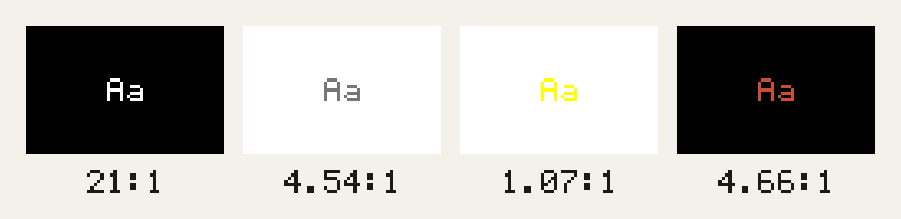

# Contrast

`contrastRatio(against:)` is the WCAG 2 contrast ratio of two opaque colors. Black on white is `21`.



| Pair | Ratio |
| --- | --- |
| White on black | 21:1 |
| #767676 on white | 4.54:1 |
| Yellow on white | 1.07:1 |
| Coral on black | 4.66:1 |

```swift
let gray = Color<SRGB>(
    red: 118.0 / 255.0,
    green: 118.0 / 255.0,
    blue: 118.0 / 255.0
)
let white = Color<SRGB>(red: 1, green: 1, blue: 1)
let ratio = gray.contrastRatio(against: white)
```

`#767676` on white is `4.54:1`.

See also [Conversions](Conversions.md), [Interpolation](Interpolation.md), [Difference](Difference.md).
