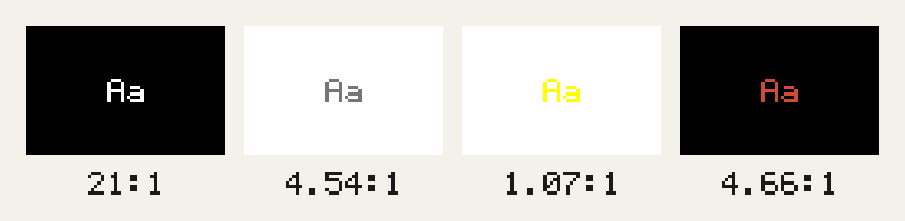

# Contrast

`contrastRatio(against:)` converts both colors to opaque sRGB and returns the WCAG 2 ratio `(L1 + 0.05) / (L2 + 0.05)`. Black on white is `21`.



The letters are the foreground. The caption is the ratio, drawn in ink so it stays readable when the sample itself fails contrast.

| Pair | Ratio |
| --- | --- |
| White on black | 21:1 |
| #767676 on white | 4.54:1 |
| Yellow on white | 1.07:1 |
| Coral on black | 4.66:1 |

```swift
let gray = Color<SRGB>(
    red: 118.0 / 255.0,
    green: 118.0 / 255.0,
    blue: 118.0 / 255.0
)
let white = Color<SRGB>(red: 1, green: 1, blue: 1)
let ratio = gray.contrastRatio(against: white)
```

`#767676` on white is `4.54:1`. WCAG defines the ratio for in-gamut sRGB. Out-of-gamut channels are not clamped and can produce a ratio outside `1...21`.

See also [[Conversions]], [[Interpolation]], [[Difference]].
