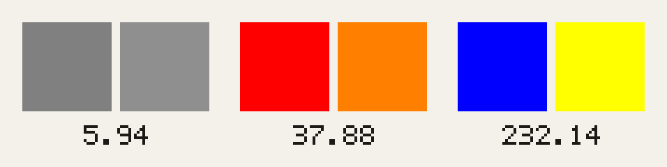

# Difference

`deltaE76(to:)` is the Euclidean distance in CIELAB. It is not CIEDE2000.



| Pair | ΔE76 |
| --- | --- |
| Near grays | 5.94 |
| Red and orange | 37.88 |
| Blue and yellow | 232.14 |

```swift
let red = Color<SRGB>(red: 1, green: 0, blue: 0)
let orange = Color<SRGB>(red: 1, green: 0.5, blue: 0)
let difference = red.deltaE76(to: orange)
```

Red against orange is the middle pair. A small step in encoded gray is a small CIE76 distance. Blue against yellow is large because their `a*` and `b*` point in opposite directions.

See also [[Conversions]], [[Interpolation]], [[Contrast]].
