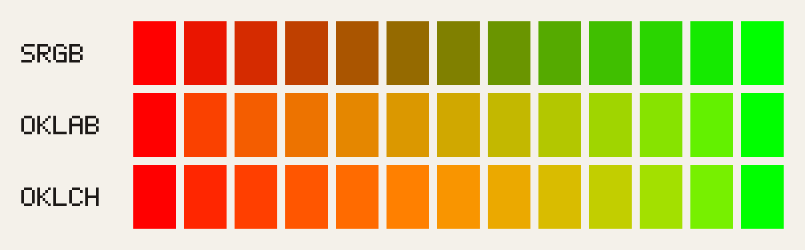

# Colorful

Colorful converts, interpolates, and compares colors in Swift. The module is `Colorful`.

Red to green in sRGB, OKLab, and OKLCH.

- [[Conversions]]
- [[Interpolation]]
- [[Contrast]]
- [[Difference]]
