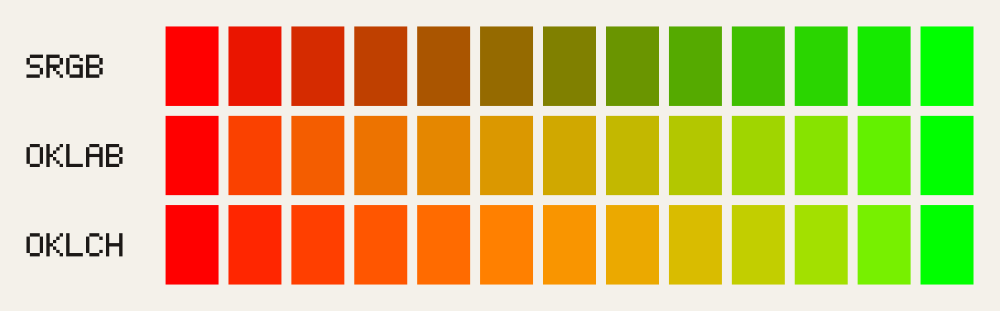
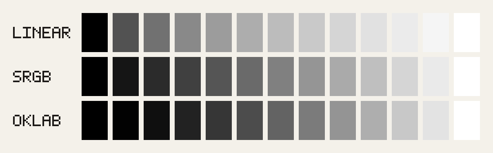
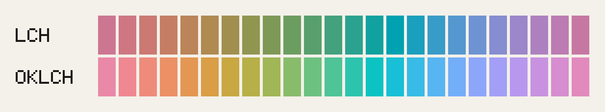

# Interpolation

`interpolated(toward:amount:in:)` mixes both colors in the given space. Hue takes the shorter arc. A neutral color has no hue, so it does not pull the mix toward `0`.

Red to green in sRGB, OKLab, and OKLCH. OKLCH hue runs from 29.2° to 142.5°.

Equal steps from 0 to 1 in linear sRGB, encoded sRGB, and OKLab.

CIELCH at L* = 60 and C* = 37. OKLCH at L = 0.74 and C = 0.125.

Amount `0` or `1` returns the original components. Other amounts can fall outside the gamut. The pictures clamp sRGB to `0...1` for display.

See also [[Conversions]], [[Contrast]], [[Difference]].
