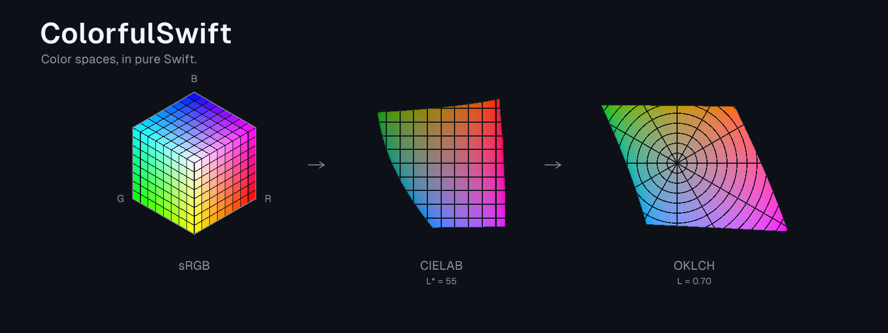
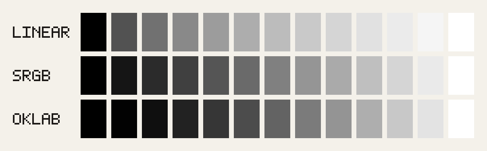

# ColorfulSwift

[](https://github.com/kreshikhin/ColorfulSwift/actions/workflows/ci.yml)
[](LICENSE)



A lightweight, cross-platform Swift library for color space conversions and color calculations.

ColorfulSwift provides strongly typed colors, conversions between common color spaces, interpolation, color difference calculations, and WCAG contrast ratios.

Written in pure Swift, with no dependencies on Foundation or platform-specific graphics frameworks. The module is `Colorful`.

## Features

- Color spaces: sRGB, linear sRGB, CIE XYZ, CIELAB, CIELCH, OKLab, and OKLCH.
- Conversions between those spaces, with an explicit type for each space.
- Interpolation in a chosen space.
- CIE76 color difference (ΔE).
- WCAG 2 contrast ratio.
- Custom color spaces and color types.

## Requirements

- Swift 6
- Swift Package Manager

The package builds for macOS, iOS, tvOS, watchOS, visionOS, Linux, and Windows.

## Installation

```swift
dependencies: [
    .package(url: "https://github.com/kreshikhin/ColorfulSwift.git", from: "0.1.0")
]
```

```swift
.target(name: "App", dependencies: [
    .product(name: "Colorful", package: "ColorfulSwift")
])
```

Versions follow [semantic versioning](https://semver.org). The first release is `0.1.0`, from the tag `v0.1.0`.

## Usage

<!-- BEGIN GENERATED USAGE -->

```swift
let color = Color<SRGB>(
    red: 0.8,
    green: 0.3,
    blue: 0.2
)
let oklab = color.converted(to: OKLab.self)
let oklch = color.converted(to: OKLCH.self)
let restored = oklch.converted(to: SRGB.self)
```

```swift
let gray = Color<SRGB>(
    red: 118.0 / 255.0,
    green: 118.0 / 255.0,
    blue: 118.0 / 255.0
)
let white = Color<SRGB>(red: 1, green: 1, blue: 1)
let ratio = gray.contrastRatio(against: white)
```

```swift
let red = Color<SRGB>(red: 1, green: 0, blue: 0)
let orange = Color<SRGB>(red: 1, green: 0.5, blue: 0)
let difference = red.deltaE76(to: orange)
```

<!-- END GENERATED USAGE -->

## Color spaces

| Space | White point | Components |
| --- | --- | --- |
| `SRGB` | D65 | Encoded `red`, `green`, `blue` |
| `LinearSRGB` | D65 | Linear-light `red`, `green`, `blue` |
| `XYZ` | D65 | `x`, `y`, `z`, with white at `Y = 1` |
| `Lab` | D50 | `L*` in `lightness`, `a`, `b` |
| `LCH` | D50 | `lightness`, `chroma`, `hue` in degrees |
| `OKLab` | D65 | `lightness`, `a`, `b` |
| `OKLCH` | D65 | `lightness`, `chroma`, `hue` in degrees |

Components are `Double` values and are not clamped. Hue is `nil` for a neutral color.

## Examples

<!-- BEGIN GENERATED EXAMPLES -->

Red to green in sRGB, OKLab, and OKLCH.


Equal steps from 0 to 1 in linear sRGB, encoded sRGB, and OKLab.



WCAG 2 contrast.


<!-- END GENERATED EXAMPLES -->

## Documentation

- [Conversions](Documentation/Guide/Conversions.md)
- [Interpolation](Documentation/Guide/Interpolation.md)
- [Contrast](Documentation/Guide/Contrast.md)
- [Difference](Documentation/Guide/Difference.md)
- [Wiki](https://github.com/kreshikhin/ColorfulSwift/wiki)

The formulas are in the DocC catalog. In Xcode, use Product → Build Documentation.

## License

[MIT](LICENSE). Copyright (c) 2026 Denis Kreshikhin.
