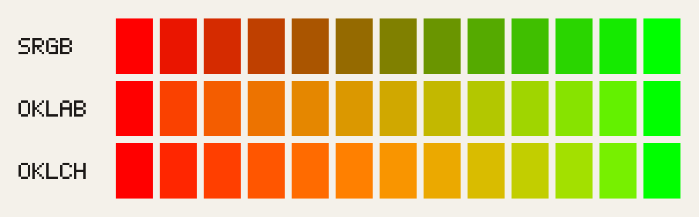
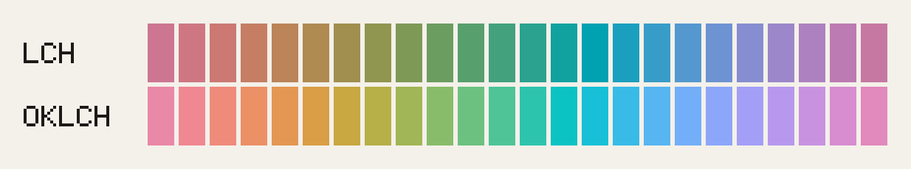
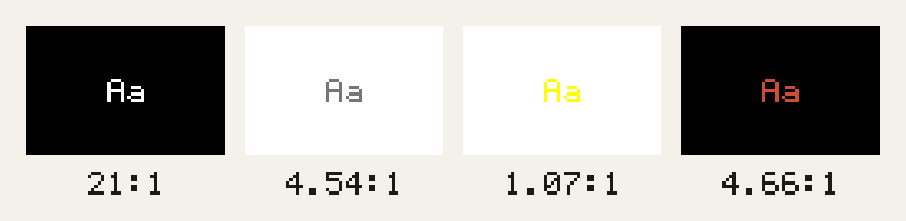
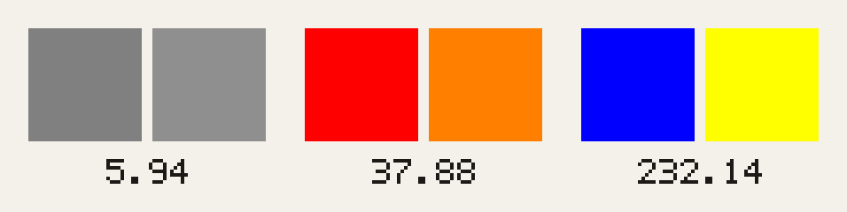

# ColorfulSwift

[](https://github.com/kreshikhin/ColorfulSwift/actions/workflows/ci.yml)
[](LICENSE)

A small Swift library for color-space conversion. No dependencies, no UIKit, AppKit, SwiftUI, CoreGraphics, or Foundation in the core. The Swift module is `Colorful`.

It converts between sRGB, linear sRGB, CIE XYZ (D65), CIELAB and LCh (D50), and OKLab and OKLCh. It also interpolates in a chosen space, computes CIE76 `ΔE*ab`, and the WCAG 2 contrast ratio for opaque sRGB colors.

<!-- BEGIN GENERATED EXAMPLES -->

Generated by `GenerateDocs`. Do not edit this section by hand.

The pictures clamp sRGB into `0...1` only while drawing. The library does not clamp.

### Interpolation



sRGB red to sRGB green, 13 steps. Encoded sRGB passes through olive. OKLab mixes the opponent axes. OKLCH keeps the chroma and takes the short hue arc from 29.2° to 142.5°, so the middle stays yellow.

### Lightness


Each row takes 13 equal steps from 0 to 1. Linear light crushes the darks into the first tile and then jumps toward white. Encoded sRGB spreads the same numbers evenly across the file. OKLab lightness follows the ramp you see.

### Hue



CIELCH at L* = 60 and C* = 37. OKLCH at L = 0.74 and C = 0.125. Twenty-four hues run from 0° up to, but not including, 360°. Chroma is the largest step that stays inside the sRGB cube.

### Contrast



WCAG 2 contrast for opaque sRGB. The sample is the foreground color. The caption is the ratio.

| Pair | Ratio |
| --- | --- |
| White on black | 21:1 |
| #767676 on white | 4.54:1 |
| Yellow on white | 1.07:1 |
| Coral on black | 4.66:1 |

### Difference



CIE76 distance after converting both colors to CIELAB. This is not CIEDE2000.

| Pair | ΔE76 |
| --- | --- |
| Near grays | 5.94 |
| Red and orange | 37.88 |
| Blue and yellow | 232.14 |

### Checked examples

These snippets are compiled and run by the `ColorfulExamples` executable.

#### Conversions

```swift
let color = Color<SRGB>(
    red: 0.8,
    green: 0.3,
    blue: 0.2
)
let oklab = color.converted(to: OKLab.self)
let oklch = color.converted(to: OKLCH.self)
let restored = oklch.converted(to: SRGB.self)
```

Coral sRGB `(0.8000, 0.3000, 0.2000)` in every built-in space. The last row converts OKLCH back to sRGB. CIE76 from the original to that round trip is `0.00`.

| Space | Components |
| --- | --- |
| `SRGB` | 0.8000, 0.3000, 0.2000 |
| `LinearSRGB` | 0.6038, 0.0732, 0.0331 |
| `XYZ` | 0.2812, 0.1832, 0.0519 |
| `Lab` | 50.5534, 50.5133, 42.3369 |
| `LCH` | 50.5534, 65.9091, 40.0° |
| `OKLab` | 0.5866, 0.1399, 0.0915 |
| `OKLCH` | 0.5866, 0.1671, 33.2° |
| `SRGB` round trip | 0.8000, 0.3000, 0.2000 |

#### Contrast

```swift
let gray = Color<SRGB>(
    red: 118.0 / 255.0,
    green: 118.0 / 255.0,
    blue: 118.0 / 255.0
)
let white = Color<SRGB>(red: 1, green: 1, blue: 1)
let ratio = gray.contrastRatio(against: white)
```

`#767676` on white is `4.54:1`.

#### Difference

```swift
let red = Color<SRGB>(red: 1, green: 0, blue: 0)
let orange = Color<SRGB>(red: 1, green: 0.5, blue: 0)
let difference = red.deltaE76(to: orange)
```

Red against orange is the middle pair in the picture above.

Longer notes:

- [Conversions](Documentation/Guide/Conversions.md)
- [Interpolation](Documentation/Guide/Interpolation.md)
- [Contrast](Documentation/Guide/Contrast.md)
- [Difference](Documentation/Guide/Difference.md)

<!-- END GENERATED EXAMPLES -->

## Requirements

- Swift 6, with strict concurrency
- Swift Package Manager

The package builds for macOS, iOS, tvOS, watchOS, visionOS, Linux, and Windows.

## Installation

```swift
dependencies: [
    .package(url: "https://github.com/kreshikhin/ColorfulSwift.git", from: "1.0.0")
]
```

```swift
.target(name: "App", dependencies: [
    .product(name: "Colorful", package: "ColorfulSwift")
])
```

Versions follow [semantic versioning](https://semver.org). A Git tag `v1.2.3` is the release `1.2.3`.

`Color<Space>` is the standard container. Another type can conform to `ColorProtocol` and use the same operations. A new space conforms to `ColorSpace` and converts through XYZ D65.

Components are `Double` and are not clamped. Conversions may fall outside the destination gamut; those values are preserved. There is no CMYK, ICC profile, palette generator, or gamut mapping.

## Color spaces

| Space | White point | Components |
| --- | --- | --- |
| `SRGB` | D65 | Encoded `red`, `green`, `blue` |
| `LinearSRGB` | D65 | Linear-light `red`, `green`, `blue` |
| `XYZ` | D65 | `x`, `y`, `z`, with white at `Y = 1` |
| `Lab` | D50 | `L*` in `lightness` (`100` at white), `a`, `b` |
| `LCH` | D50 | `lightness`, `chroma`, `hue` in degrees |
| `OKLab` | D65 | `lightness` (`1` at white), `a`, `b` |
| `OKLCH` | D65 | `lightness`, `chroma`, `hue` in degrees |

Hue is `nil` when the color is neutral. `LCH` treats chroma at or below `1e-6` as neutral, and `OKLCH` uses `1e-8`. A missing hue converts back to `a = 0` and `b = 0`.

## Mathematical conventions

The formulas match the definitions used by CSS Color Module Level 4's sample conversion code, which is a direct transcription of the standards below.

**sRGB.** IEC 61966-2-1. The encoded threshold is `0.04045` and the linear-light threshold is `0.0031308`. Negative channels mirror the positive curve through the origin. The XYZ matrix is the exact rational matrix derived from the IEC primaries `(0.64, 0.33)`, `(0.30, 0.60)`, `(0.15, 0.06)` and the D65 chromaticity `(0.3127, 0.3290)`.

**D65.** `X = 0.3127 / 0.3290`, `Y = 1`, `Z = (1 - 0.3127 - 0.3290) / 0.3290`. This is the white point of `XYZ`, sRGB, and OKLab.

**CIELAB.** CIE `L*a*b*` with `ε = 216 / 24389` and `κ = 24389 / 27`. The reference white is D50 at chromaticity `(0.3457, 0.3585)`, scaled so that `Y = 1`. D65 and D50 are connected by the linear Bradford chromatic adaptation, so sRGB white is `L* = 100`, `a* = 0`, `b* = 0`.

**OKLab.** Björn Ottosson's OKLab, with the D65-consistent matrices from CSS Color 4. Those matrices keep neutral sRGB on `a = 0`, `b = 0`. Cube roots keep their sign, so out-of-gamut colors stay defined. This is not the earlier matrix set from the OKLab blog post, which assumed a slightly different D65.

**Interpolation.** Component-wise in the space you ask for. Hue takes the shorter arc. A neutral color does not contribute a hue, so it does not pull the mix toward hue `0`. Amount `0` and `1` return the original components. Other amounts may extrapolate.

**ΔE76.** Euclidean distance in CIELAB. This is not CIEDE2000.

**WCAG 2 contrast.** Both colors are converted to opaque sRGB. Relative luminance uses the WCAG coefficients `0.2126`, `0.7152`, and `0.0722` after the IEC transfer. The result is `(L1 + 0.05) / (L2 + 0.05)`, so black on white is `21`. WCAG specifies this for in-gamut sRGB. Out-of-gamut channels are not clamped and can produce a ratio outside `1...21`.

Ordinary round trips agree to about `1e-7`, and extreme out-of-gamut colors to about `1e-6`. The IEC thresholds `0.04045` and `0.0031308` are not exact inverses of each other, so a channel sitting on `0.04045` comes back about `3e-8` away. Reference comparisons in the test suite use `1e-8`. Identity conversion does not pass through XYZ.

DocC comments on the public types repeat these conventions for the documentation browser. Build them from Xcode with Product → Build Documentation.

## Documentation

The pictures, tables, and checked snippets are generated. Regenerate them after a behavior change:

```sh
swift run GenerateDocs
swift run GenerateDocs -- --check
swift run ColorfulExamples
```

`--check` compares the generated files and exits non-zero when they are stale. It does not write. `ColorfulExamples` compiles the snippets shown in the README.

The same pages, with the pictures, are written to `Documentation/Wiki` for the GitHub wiki. GitHub creates `ColorfulSwift.wiki.git` only after the first wiki page exists, so that folder is the source to publish once the wiki repository is there.

## License

[MIT](LICENSE). Copyright (c) 2026 Denis Kreshikhin.
